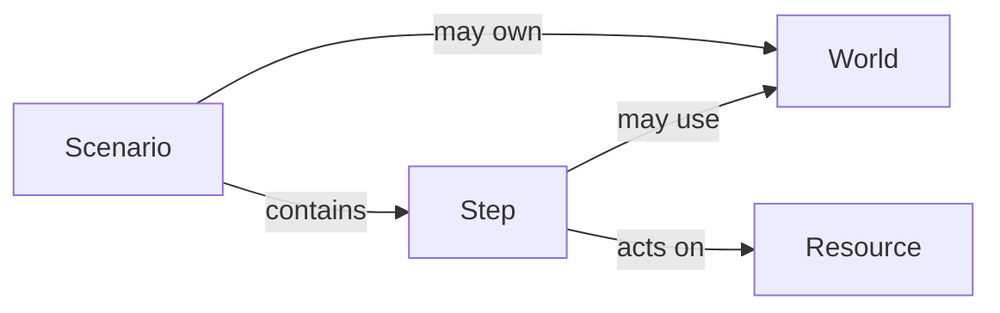

# Raun

Raun is an integration testing framework for .NET. Write scenarios as C# methods with
`Given`, `When`, and `Then` steps. Each step gets its own test result. When a step fails,
steps that depend on it are skipped; independent branches can continue.

- A **scenario** describes one behavior you want to test.
- A **step** does setup, performs an action, or checks a result. It is a reusable C# method.
- A **world** holds the infrastructure and state shared by one scenario's steps.
- A **resource** is something steps create, read, change, or delete, identified by a stable key.



See [how scenarios run](docs/explanation/execution-model.md) for the execution model.

## Start with a scenario

Write one scenario for one behavior, such as booking an appointment or rejecting an unauthorized request.

```csharp
[Scenario("customer books an appointment")]
public async Task Booking()
{
    var patient = await Given.PatientExists("Jane");
    var slot = await Given.AvailableSlot();

    var appointment = await When.CreateAppointment(patient, slot);

    await Then.AppointmentExists(appointment);
}
```

The snippets on this page are excerpts from runnable samples, rather than a complete project.
See the [scenario class](samples/AppointmentTests/Scenarios.cs) and [step definitions and suite](samples/AppointmentTests/AppointmentDsl.cs).
Run the sample from this repository with **.NET SDK 10.0.300 or later**:

```bash
dotnet run --project samples/AppointmentTests -- --report-html --results-directory "$PWD/out"
```

For your own project:
```bash
dotnet new console -n MyScenarios
cd MyScenarios
dotnet add package Raun.Mtp --prerelease
dotnet add package xunit.v3.assert
```

Delete the template's `Program.cs`; Raun generates the entry point. Add a scenario class
derived from `Scenarios`, its step classes, and any domain types. Run with `dotnet run -- --report-html`.
The [GettingStarted sample](samples/GettingStarted) is a complete app with a generated entry point.
The [authoring reference](docs/reference/scenario-authoring.md) covers the class wiring;
[running tests](docs/reference/running-tests.md) covers `dotnet test`, selection, and runner options.

## Reuse steps and give them readable titles

Use a shared step when several scenarios perform the same operation or check.
Steps live in classes such as `AppointmentGiven : Given`. A suite exposes them
through properties such as `public AppointmentGiven Given => Steps<AppointmentGiven>();`.
They return ordinary `Task` or `Task<T>` values and can use your preferred assertion library.

Use `[StepName]` to explain a call in the report, including the values that matter. This [assertion step](samples/AppointmentTests/AuthorizationScenarios.cs)
uses the expected status in its title:

```csharp
[StepName("Then the status is {expected}")]
public Task StatusIs(HttpStatusCode actual, HttpStatusCode expected)
{
    Assert.Equal(expected, actual);
    return Task.CompletedTask;
}
```

Titles can also show member values, optional arguments, and completed results; see the [resource tracking sample](samples/AppointmentTests/ResourceTrackingScenarios.cs).

## Run the same scenario with different inputs

Use `[ScenarioCase]` when the same behavior needs checking with different roles, endpoints, or values.
Each named row runs separately. The [authorization sample](samples/AppointmentTests/AuthorizationScenarios.cs) checks endpoint access:

```csharp
[Scenario("endpoint access")]
[ScenarioCase("anonymous", "/appointments", EndpointRole.Anonymous, HttpStatusCode.Unauthorized)]
[ScenarioCase("reader cannot administer", "/admin/appointments", EndpointRole.Reader, HttpStatusCode.Forbidden)]
public async Task EndpointAccess(string endpoint, EndpointRole role, HttpStatusCode expected)
{
    var status = await When.Request(endpoint, role);
    await Then.StatusIs(status, expected);
}
```

Each case has its own world, service scope, setup, and teardown. This example uses a local
handler; the [Aspire sample](samples/AspireAppointments/README.md) makes real HTTP calls.

## Add state, services, and cleanup

Use a world when steps share state that belongs to one scenario, such as a tenant or stub server.
Derive from `Scenarios<TWorld>` and matching step bases such as `Given<TWorld>`. Define the world with
`IScenarioWorld<TWorld>.CreateAsync(ScenarioContext)`. Raun creates it during Setup.
Steps access it through `World`; `Context` provides services, cancellation, logs, and cleanup.

The [cancellation sample](samples/AppointmentTests/CancellationScenarios.cs) registers cleanup immediately:

```csharp
var isolation = await TestIsolation.CreateAsync(seed, context.CancellationToken);
context.OnTeardown(Cleanup.Required, teardown =>
{
    teardown.Log($"released {isolation.Tenant}");
    return isolation.ReleaseAsync();
});
```

Register cleanup as soon as you create something that must be released. Use `Cleanup.Required`
when leaving it behind would affect later tests. Set step or scenario time limits for work that may hang.
Cleanup runs in Teardown; disposable worlds are released there too.

Use dependency injection for application services and clients you already register. Resolve them from
`context.Services` in the world factory, or inject them into step classes as in the [service sample](samples/AppointmentTests/ServiceScenarios.cs).

## Run independent steps together and follow branches

Use parallel groups when operations do not depend on each other, such as creating a patient and a slot.
Steps otherwise run in source order. Await a tuple to run the group together:

```csharp
var (patient, slot) = await (
    Given.PatientExists("Jane"),
    Given.AvailableSlot());
```

Use a branch when later steps depend on an earlier result. An awaited condition step chooses the arm:

```csharp
Appointment appointment;
if (await Given.PatientIsPriority(patient))
    appointment = await When.CreateUrgentAppointment(patient, slot);
else
    appointment = await When.CreateAppointment(patient, slot);
```

The other arm is reported as skipped. See [conditional scenarios](samples/AppointmentTests/Scenarios.cs)
and [`switch` branches](samples/AppointmentTests/BookingOutcomeScenarios.cs).

## Track what steps touch

Use resources when you need to follow the same patient, booking, or other entity across steps.
A resource's `IResource<T>.KeyFor` supplies its identity. Step attributes describe its use:

```csharp
public sealed class Reserved : UpdatedAttribute;
public sealed class Booked : CreatedAttribute
{
    public sealed class PatientAttribute : ResourceLinkAttribute<Patient, ReadAttribute>;
    public sealed class SlotAttribute : ResourceLinkAttribute<Slot, Reserved>;
}

[StepName("When booking {patient} in {slot}")]
[return: Booked]
public Task<Appointment> CreateAppointment(
    [Booked.Patient] Patient patient, [Booked.Slot] Slot slot)
```

This [booking step](samples/AppointmentTests/AppointmentDsl.cs) reads a patient, reserves a slot,
and creates an appointment linked to both. The four effects are **Create, Read, Update, Delete**:
Read allows shared access; the other three require exclusive access. `[Seed]` records a Create
with the label Seed for data inserted behind the scenes. Use `[Created]` for creation through the system.
The step code performs the real operation; attributes record what it does.

Links describe relationships and grant no access. Nested role attributes package a typed link with
an input action. The equivalent raw form is `[Read, Link<Booked>("Patient")]` on the patient and
`[Reserved, Link<Booked>("Slot")]` on the slot. Required roles must be bound once; an ambiguous owner
requires `Source = nameof(parameter)` or `Source = Subject.Return`.

A custom action inherits its base effect's conflict rules. Its name defaults to the class name with
`Attribute` removed; `[DisplayName("Reserve")]` can override it. See the
[domain attributes](samples/AppointmentTests/BookingAttributes.cs),
[action sample](samples/AppointmentTests/ResourceActionScenarios.cs), and
[resource reference](docs/reference/resources.md).

Alternate representations can share an identity through `IResourceAlternate<T>` on the resource owner,
or `Identify<Patient>().With<PatientRow>(row => row.Id)` in custom-host configuration.
Use `[ResourceKey<Patient>] string patientId` for a key-only input; it also works with a packaged role.
Later steps can reuse readable labels from preceding dependencies without borrowing their object snapshots.
The [registry sample](samples/AppointmentTests/RegistryBookingScenarios.cs) and
[tracking sample](samples/AppointmentTests/ResourceTrackingScenarios.cs) show these features together.
Scenario-wide external-system access remains independent: `[Uses<T>(LockMode.Exclusive)]` holds its
admission token through setup, execution, teardown, and scope disposal.

## Tag scenarios and run a subset

Tag a scenario, its class, or the assembly with `key=value` pairs, then run only what matches:

```csharp
[Scenario("bulk user import")]
[Tag("area", "users")]
public async Task ImportUsers() { ... }
```

```bash
dotnet run -- --treenode-filter '/**[area=users]'
```

Your own attribute can stand for a set of tags. Tags also show in the IDE, the TRX, and the HTML report,
which filters by them. See [tags](docs/reference/scenario-authoring.md#tags).

## Read the report when something fails

Use the HTML report to inspect a failure or share a run. It includes step results, a resource matrix, and errors. Gantt bars behind the step titles show when steps ran and
which overlapped. Nested `if` / `switch` branches keep their source labels; untaken branches are folded
and can be expanded. Select a step duration to inspect named prerequisites or jump to an earlier step. Add `.Note(...)` to explain why a step matters. Use logs for values and events observed during it:

```csharp
Context.Log($"{endpoint}: {(int)status} {status}");
```

Use `Context.AddAttachment` for a response body or other text you want to inspect in full, as in the
[reminder step](samples/AppointmentTests/LifecycleDsl.cs). See
[logging and attachments](docs/reference/scenario-authoring.md#notes-logs-and-attachments) and
[report options](docs/reference/running-tests.md#reports-and-test-selection).

Resource lanes that do not fit open in an overlay aligned with the scenario. Type and method names reveal in italics on hover or focus; add `--report-source-base-url` to link them to source. See [source navigation](docs/reference/running-tests.md#source-navigation).

## Bring up real infrastructure and share its capacity

Use `Raun.Aspire` when your tests need an Aspire application running. It starts the AppHost once
in Preflight and waits for named resources. The
[Aspire sample](samples/AspireAppointments/README.md) tests an API as different users;
its [entry point](samples/AspireAppointments/AspireAppointments.Tests/Program.cs) configures clients.

Use capacity limits when concurrent scenarios could interfere with shared infrastructure.
The [schedule resource](samples/AspireAppointments/AspireAppointments.Tests/Scenarios.cs)
allows concurrent bookings while clearing requests exclusive access:

```csharp
[SharedResource]
public sealed class Schedule : IContendedResource;

[Uses<Schedule>(LockMode.Exclusive)]
```

Use shared access when scenarios can safely use the service together, exclusive access when a scenario
needs it to itself, and a pool when only a fixed number may use it at once. Raun waits before Setup
and holds capacity through teardown. See [shared capacity](docs/reference/running-tests.md#concurrent-scenarios-and-shared-capacity).

## Check code coverage

Use code coverage to find paths your tests do not reach, then add scenarios for the behavior that matters.
Add `Raun.Coverage` and a coverage collector to see which branches your tests exercise.
The report shows total branch coverage and coverage of your logic. Argument checks,
error handling, null propagation, and logging are classified separately.

With Microsoft Code Coverage registered, run:

```bash
dotnet run -- --report-html --coverage --coverage-output-format xml
```

See the sample's [collector setup](samples/AspireAppointments/AspireAppointments.Tests/Program.cs)
and [coverage commands](samples/AspireAppointments/README.md#coverage-and-traces). Coverlet is also supported.

Browse the [sample guide](samples/AppointmentTests/README.md) and [design notes](docs/superpowers/specs).
Apache License 2.0. See [LICENSE](LICENSE) and [NOTICE](NOTICE).
