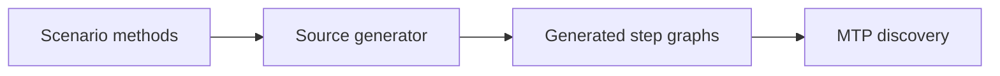
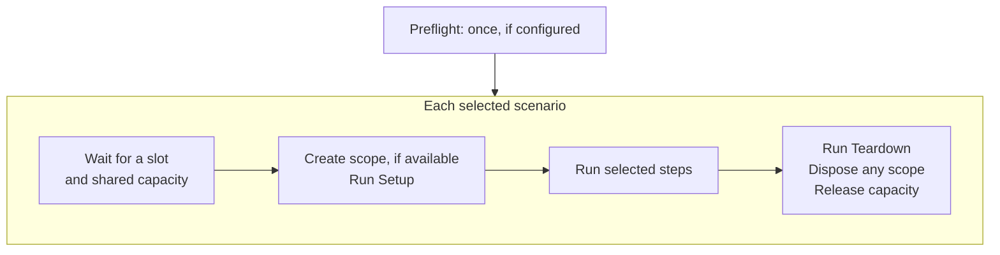
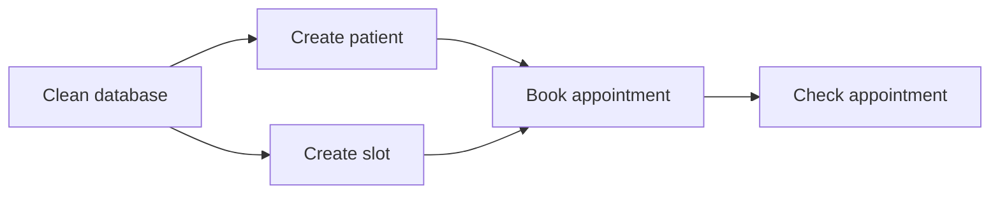

# How scenarios run

[Start here](../../README.md) · [Writing scenarios](../reference/scenario-authoring.md) · [Running tests](../reference/running-tests.md)

## How scenario methods become tests

The source generator reads scenario methods during the build and produces step graphs.
Microsoft.Testing.Platform (MTP) discovers the steps of those graphs as tests. The runtime runs the
generated graph. It does not call the scenario method itself.
The generator produces one graph for each named scenario case.

## One run

If a preflight is configured, it starts shared infrastructure once per test host. If the preflight fails, the run skips the scenarios.
An optional `sessionPreflight` hook then runs in every test session. Use it to reset state between runs that share that infrastructure.
For each selected scenario, the normal flow is:

Several scenarios can run at once. Each world belongs to one scenario. Setup creates the world when the scenario uses one.
If the service provider supports scopes, each scenario gets its own scope. A scenario holds the capacity it declares with `[Uses<T>]`
until Teardown and scope disposal finish.

Raun sends each step result to MTP and to the report as the step finishes. The HTML report lists scenarios
in registration order. Selecting one step also selects its prerequisites and Teardown.

## Parallel steps

By default, steps run in source order. An explicit parallel group lets independent steps run at the same time.
In the [parallel booking example](../../samples/AppointmentTests/Scenarios.cs), booking waits
until both the patient and slot exist:

If a step fails, the steps that depend on it are skipped. Independent steps keep running.
An `if` or `switch` runs only its chosen arm. The run reports the other arms as not taken.
Teardown waits for running steps to stop, then applies the cleanup policy.
See [cleanup and timeouts](../reference/scenario-authoring.md#cleanup-and-timeouts) for cancellation limits.

Raun uses resource roles such as `[Read]` and `[Edited]` to detect conflicting access inside a scenario.
The `[Uses<T>]` capacity rules decide which scenarios may run together.
See [resource rules](../reference/resources.md#resource-roles-and-conflicts) and
[shared capacity](../reference/running-tests.md#concurrent-scenarios-and-shared-capacity).

The implementation is in the [generator](../../src/Raun.Generator/ScenarioGenerator.cs),
[run loop](../../src/Raun/Running/RunLoop.cs), and [step scheduler](../../src/Raun/Scheduling/ScenarioScheduler.cs).
