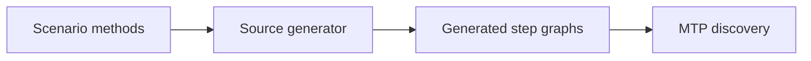
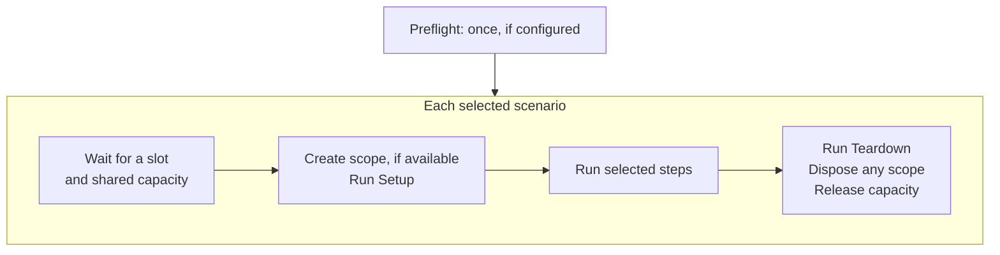
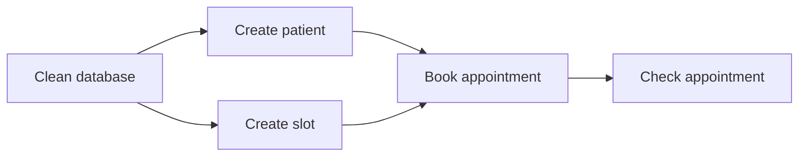

# How scenarios run

[Start here](../../README.md) · [Writing scenarios](../reference/scenario-authoring.md) · [Running tests](../reference/running-tests.md)

## From C# to tests

The source generator reads scenario methods during the build and produces step graphs.
Microsoft.Testing.Platform (MTP) discovers their steps as tests. The runtime executes the
generated graph; it does not call the scenario method directly.
Each named scenario case produces its own graph.

## One run

Preflight starts shared infrastructure once, when configured. A failure there skips the scenarios.
For each selected scenario, the normal flow is:

Several scenarios can run at once. A world belongs to one scenario; Setup creates it when used.
If the service provider supports scopes, each scenario gets its own scope. Capacity declared with `[Uses<T>]` is held
until teardown and scope disposal finish.

Step results go to MTP and the report as work finishes. The HTML report lists scenarios
in registration order. Selecting one step also selects its prerequisites and teardown.

## Parallel steps

Steps normally run in source order. An explicit parallel group allows independent steps to overlap.
In the [parallel booking example](../../samples/AppointmentTests/Scenarios.cs), booking waits
until both the patient and slot exist:

If a step fails, dependent steps are skipped; independent work can continue.
An `if` or `switch` runs only its chosen arm. Other arms are reported as not taken.
Teardown waits for running steps to stop, then applies the cleanup policy.
See [cleanup and timeouts](../reference/scenario-authoring.md#cleanup-and-timeouts) for cancellation limits.

Resource roles such as `[Read]` and `[Edited]` detect conflicting access inside a scenario.
The `[Uses<T>]` capacity rules decide which scenarios may run together.
See [resource rules](../reference/resources.md#resource-roles-and-conflicts) and
[shared capacity](../reference/running-tests.md#concurrent-scenarios-and-shared-capacity).

The implementation is in the [generator](../../src/Raun.Generator/ScenarioGenerator.cs),
[run loop](../../src/Raun/Running/RunLoop.cs), and [step scheduler](../../src/Raun/Scheduling/ScenarioScheduler.cs).
